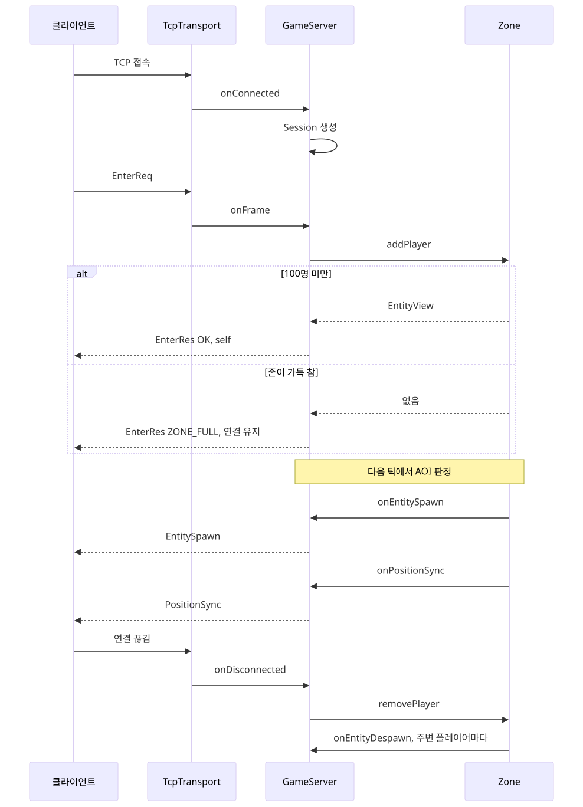

# 서버 흐름

## 접속과 입장

## 틱

## 패킷 처리

TCP 스트림을 프레임으로 자르는 일은 `TcpTransport`가 합니다.

완성된 프레임의 검증과 처리는 `GameServer`가 합니다.

## 스레드

서버 로직은 스레드 하나에서 돌아갑니다. 콘솔 종료 신호만 다른 스레드에서 들어옵니다.

## 플레이어 행동과 공격

클라이언트는 대상만 지정합니다. 접근과 타격은 서버가 틱마다 처리합니다.

## 보상과 레벨업

## 슬라임 상태

